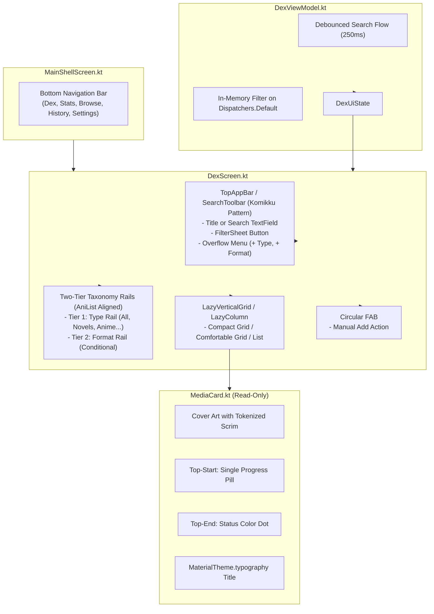

# Phase 1: Dex Screen UI Unslop & Komikku Alignment

> **Document**: `01-dex-unslop-plan.md`  
> **Status**: Approved Implementation Plan  
> **Target Surface**: `DexScreen.kt`, `MediaCard.kt`, `MainShellScreen.kt`, `DexViewModel.kt`  
> **Design References**: Komikku Library Presentation (`.tmp/komikku/app/src/main/java/eu/kanade/presentation/library/`), AniList GraphQL Schema Taxonomy  
> **Verification**: `./gradlew testDebugUnitTest` and `./gradlew assembleDebug`

---

## 1. Executive Summary

Transform LazyDex's main library surface (`DexScreen`) from an over-decorated AI-slop layout into a clean, restrained, production-grade Android media tracker following **Komikku's battle-tested Material 3 library architecture** and **AniList's standard taxonomy**.

### Key Architectural Decisions
1. **Primary Navigation & FAB Resolution**:
   - Re-label bottom nav center item from "Add" to "Browse" (`Icons.Outlined.Explore`). Eliminates dual "Add" button conflict.
   - Retain compact circular FAB on `DexScreen.kt` for instant manual item creation.
2. **Zero Inline Editing on Library Cards (Komikku Model)**:
   - Strip `+1` button and `TrackProgressDialog` taps from `MediaCard.kt`. Dex screen is a clean reading/viewing surface.
   - Tapping any card performs single primary action: navigates to item detail/edit screen.
3. **Restrained Cover Badges (Komikku Model)**:
   - Top-Start: Single progress pill (e.g. `Ch. 45` or `45 / 100`).
   - Top-End: Minimal status color dot (Reading, Completed, On Hold).
   - Artwork First: Remove format badges, score badges, and sync icons from grid cover overlays. Use standard Material tokenized scrims.
4. **AniList Taxonomy Alignment**:
   - "Category" $\rightarrow$ **Type** (`ANIME`, `MANGA`, `NOVEL`, `GAME`, `MOVIE`, `TV`).
   - "Subtype" $\rightarrow$ **Format** (`TV`, `TV_SHORT`, `MOVIE`, `OVA`, `NOVEL`, `MANGA`, etc.).
   - Tier 1: Scrollable **Type** rail (`All`, `Novels`, `Anime`, `Manga`, `Games`...).
   - Tier 2: Scrollable **Format** rail (conditional, rendered only when selected Type has formats).
   - Creation actions (`+ Type` and `+ Format`) moved out of daily browse rails into TopAppBar overflow `DropdownMenu`.
5. **Komikku `SearchToolbar` Integration**:
   - Adopt Komikku's `SearchToolbar` pattern (`AppBar.kt#L310`): `searchQuery: String?` where `null` displays title and `non-null` displays `BasicTextField`.
   - Wire search query to `DexViewModel` with `250ms` debounce on `Dispatchers.Default`.
   - Create `DexViewModelTest.kt` with JUnit 5 + Turbine.

---

## 2. Component Architecture & Data Flow

---

## 3. Detailed Component Specifications

### 3.1 MainShellScreen (`app/src/main/java/app/lazydex/ui/navigation/MainShellScreen.kt`)
- Bottom navigation center item #3:
  - Icon: `Icons.Outlined.Explore` (selected: `Icons.Filled.Explore`)
  - Label: `"Browse"`
  - Content description: `"Browse"`

### 3.2 MediaCard (`app/src/main/java/app/lazydex/ui/components/MediaCard.kt`)
- Remove all `+1` increment buttons (`onIncrementProgress`).
- Remove inline `TrackProgressDialog` dialog triggers (`showPrimaryDialog`, `showSecondaryDialog`).
- Simplify `COMPACT_GRID` and `COMFORTABLE_GRID`:
  - `TopStart`: `Badge(text = formatProgress(displayProgress), ...)` if `showProgressBadge`.
  - `TopEnd`: Small circular status dot (6dp circle with `statusColor`).
  - No format badge, score badge, or sync icons occluding artwork.
  - Scrim: `Brush.verticalGradient(listOf(Color.Transparent, MaterialTheme.colorScheme.scrim.copy(alpha = 0.75f)))`.
  - Typography: `MaterialTheme.typography.titleSmall` on title.

### 3.3 DexScreen (`app/src/main/java/app/lazydex/ui/dex/DexScreen.kt`)
- Replace raw `TextField` top bar with Komikku-style `SearchToolbar`:
  - Search closed: displays `"Dex"` title, Search icon, Filter icon, and Overflow (3-dots) menu.
  - Overflow menu contains: `"New Type"` and `"New Format"`.
  - Search open: displays Back button, `BasicTextField` with soft keyboard focus, and Clear button.
- FAB: Standard circular `FloatingActionButton` (replaces `ExtendedFloatingActionButton`).
- Taxonomy Rails:
  - Tier 1: `FilterChip` items for top-level **Types** (`cat.name`), plus `"All (${uiState.totalCount})"`. No `+ Category` AssistChip.
  - Tier 2: `FilterChip` items for **Formats** (`sub.name`), plus `"All ${activeType?.name}"`. No `+ Type` AssistChip.

### 3.4 DexViewModel (`app/src/main/java/app/lazydex/ui/dex/DexViewModel.kt`)
- Add `searchQuery = MutableStateFlow<String?>(null)`.
- Apply `.debounce(250).distinctUntilChanged()` before combining with item list.
- Run filtering on `Dispatchers.Default` for query match on `title`, `author`, `titleEnglish`, `titleRomaji`.

---

## 4. Verification Gates
1. **Unit Tests**: `DexViewModelTest.kt` passes with JUnit 5 + MockK + Turbine.
2. **Build Verification**: `./gradlew testDebugUnitTest` passes with 0 errors.
3. **Assemble Verification**: `./gradlew assembleDebug` compiles successfully.

