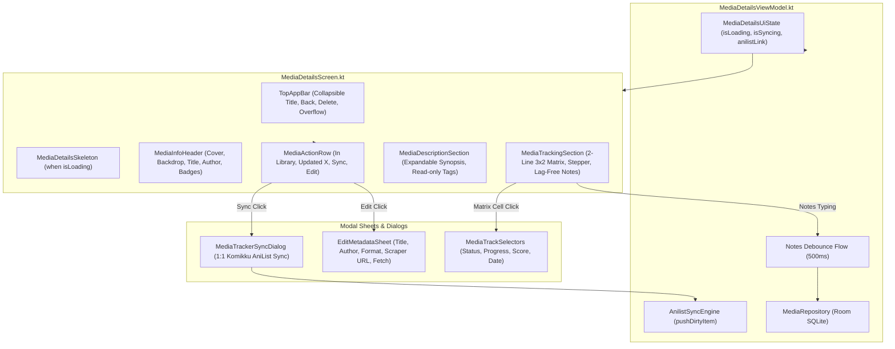

# Phase 2: Media Details Screen UI/UX Overhaul & Komikku Alignment

> **Document**: `02-details-overhaul-plan.md`  
> **Status**: Approved Implementation Plan  
> **Target Surface**: `app/src/main/java/app/lazydex/ui/details` (`MediaDetailsScreen.kt`, `MediaDetailsViewModel.kt`, `components/*`)  
> **Design References**: Komikku Presentation (`TrackInfoDialogHome.kt`, `MangaInfoHeader.kt`), `AnilistSyncEngine.kt`  
> **Verification**: `./gradlew testDebugUnitTest` and `./gradlew assembleDebug`

---

## 1. Executive Summary

Transform LazyDex's Media Details screen from a fragmented, confusing hybrid scraper/editor into a polished, high-fidelity media tracking experience. Align layout and interaction semantics strictly with **Komikku's battle-tested Material 3 architecture** and connect with LazyDex's native **AniList sync engine**.

### Key Architectural Decisions
1. **Hero Header & Backdrop**:
   - Full-bleed blurred cover backdrop with vertical gradient scrim (`MediaInfoHeader.kt`), supporting both local cached covers (`coverImagePath`) and remote artwork (`coverImageUrl`, `bannerImage`).
   - Clean 2:3 aspect ratio cover art with rounded corners.
   - Secondary info row displaying both the source/host AND total chapter/unit count simultaneously.
   - Complete removal of the permanent URL scraper banner from the main reading/viewing surface.
2. **Standard 4-Button Action Row (Komikku Model)**:
   - Button 1: **In Library** (`Icons.Filled.Favorite` / `Icons.Outlined.FavoriteBorder`) — Toggles library membership (prompts delete confirmation if saved, adds item if new). Long click opens Category/Format picker.
   - Button 2: **Updated** (`Icons.Default.HourglassEmpty` / `Icons.Default.Schedule`) — Displays relative elapsed time since `lastUpdated` (e.g. "Updated 2d ago", "Updated today"). Tap shows exact timestamp.
   - Button 3: **Sync** (`Icons.Outlined.Sync`) — Opens 1:1 Komikku-style AniList Tracker Sync dialog.
   - Button 4: **Edit** (`Icons.Outlined.Edit`) — Opens `EditMetadataSheet` for editing Title, Author, Format, Total Units, Synopsis, and Source URL scraper.
3. **1:1 Komikku AniList Tracker Sync Dialog (`MediaTrackerSyncDialog.kt`)**:
   - Linked State: Displays AniList tracker logo, remote title, overflow menu (Open in browser, Copy link, Unlink).
   - Tracker Matrix Card: 3x2 matrix showing remote Status, Chapters, Score, Start Date, Finish Date. Tapping a cell updates remote AniList entry.
   - Unlinked State: Displays AniList card with "Not Linked", remote ID input / search trigger, and "Sync Now" button (`AnilistSyncEngine.pushDirtyItem(mediaId)`).
   - Logged-out State: Displays "Not connected to AniList" with shortcut button to open Tracking Settings.
4. **Two-Line Labeled Tracking Matrix (Komikku Model)**:
   - Row 1: `STATUS` (33%), `PROGRESS` (33%), `SCORE` (33%).
   - Row 2: `STARTED` (50%), `FINISHED` (50%).
   - Line 1: `labelSmall` in `onSurfaceVariant` (`STATUS`, `PROGRESS`, `SCORE`, `STARTED`, `FINISHED`).
   - Line 2: `titleSmall` / `bodyMedium` bold value (`Reading`, `Ch. 12 / 100`, `4.5 ★`, `Oct 12, 2026`, or `—`).
   - Clean continuous card with unified dividers.
5. **Lag-Free Notes Persistence**:
   - Local state hoisting in `remember { mutableStateOf(notes) }` eliminates composition latency.
   - ViewModel 500ms debounce on `MutableStateFlow<String>` stops SQLite write thrashing.
   - Guaranteed flush on `onBackPress()`, `save()`, and `DisposableEffect`.
6. **Data & State Hardening**:
   - Explicit `isLoading: Boolean` state in `MediaDetailsUiState` with shimmer skeleton (`MediaDetailsSkeleton.kt`).
   - Fix false-dirty back-press bug in `checkBackPressAllowed()` (`orig == null` guard).
   - Category-aware `TrackStatusSelector`: Novels/Manga show "Reading", Anime/TV show "Watching", Games show "Playing".
   - Surface scraper and database errors via `SnackbarHost`.

---

## 2. Component Architecture & Data Flow

---

## 3. Verification Gates
1. **Unit Tests**: `MediaDetailsViewModelTest.kt` passes with JUnit 5 + MockK + Turbine.
2. **Build Verification**: `./gradlew testDebugUnitTest` passes with 0 errors.
3. **Assemble Verification**: `./gradlew assembleDebug` compiles successfully.

